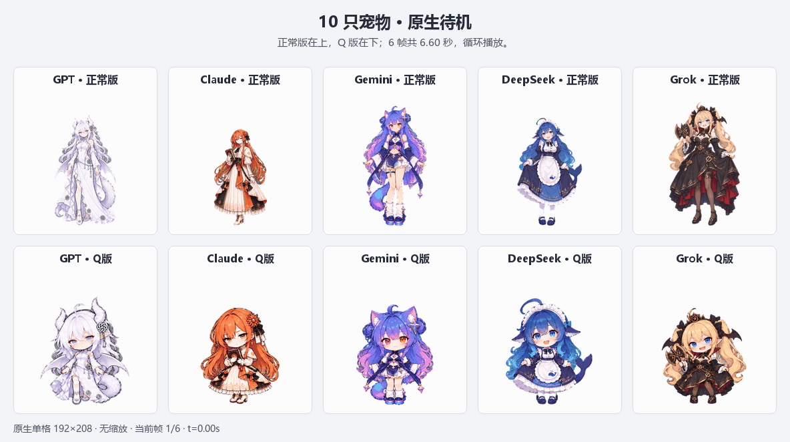

# Codex AI Companions

五位 AI 模型二次元伙伴：DeepSeek 鲸鱼娘、GPT 龙娘、Claude 娘、Grok 娘、Gemini 双子猫娘。每位包含正常版和 Q 版，共十种形态。

本仓库保存 Windows 独立桌宠、Codex Hooks 状态桥接、360 条角色台词、十只原生 Pet 的 v3 动作素材，以及继续开发所需的生成源图、提示词和检查记录。


## 两种使用方式

| | Windows 独立桌宠 | Codex 原生 Pet |
| --- | --- | --- |
| 入口 | 本仓库的 WPF 程序 | Codex 的 Pets 功能 |
| 角色 | 五角色 × 正常/Q 自动轮换 | 一次选中一只 |
| 台词 | 360 条，按角色、形态和任务状态洗牌 | 原生能力控制 |
| 状态 | Hooks + 本地会话生命周期事件 | 原生客户端控制 |
| 动画 | 当前是状态立绘与轻微浮动 | 9 类动作 + 16 个注视方向 |

## 在另一台 Windows 电脑继续

安装 Git、Node.js 20+、Codex 桌面版。编译使用 Windows 自带的 .NET Framework 4.x C# 编译器及 WPF 程序集。

```powershell
git clone https://github.com/chenachen/codex-ai-companions.git
cd codex-ai-companions
npm ci
npm test
npm run build
npm start
```

`npm run build` 从源码生成 `outputs/desktop-pet/AI-Girl-Pet.exe` 和本机 Node 路径配置；`npm start` 创建桌面快捷方式并打开桌宠。源码仓库不包含 EXE、旧机器的安装配置或运行记录。

需要接入 Codex 任务状态时，在此电脑单独运行：

```powershell
npm run hooks:install
```

这一步会备份并修改当前用户的 Codex Hooks 配置，保留其他 Hook，登记本项目的七个事件处理器。请使用支持 Hooks 的 Codex 版本。CLI 自动从 Windows 桌面版安装目录查找；必要时指定：

```powershell
$env:CODEX_CLI_PATH = 'C:\path\to\codex.exe'
npm run hooks:install
```

自定义 Codex 配置目录可通过 `CODEX_HOME` 指定。桌宠默认不随开机启动；退出桌宠会结束它启动的桥接进程。更多操作见 [桌宠说明](outputs/desktop-pet/使用说明.md)。

## 原生 Pet 素材

最新版本位于 `outputs/pet-motion-v3/<角色>-<normal|chibi>/spritesheet.png`。每张图集为 1536×2288，单格 192×208，共 73 个有效帧。源素材、提示词与检查记录在 `work/native-pets/`、`work/pet-motion-v3/`。



[工作三轮后进入待机的时序演示](outputs/pet-motion-v3/all-pets-working-then-idle.gif) · [最终文件校验清单](docs/native-pets-manifest.json)

仓库提供素材，不会自动把 Pet 添加到其他人的账号。使用 Codex Pets 插件按其验证、上传流程导入；同一账号继续编辑已有 Pet 时应更新原 ID，不要重复创建。

**已知原生限制：** 当前查验版本的待机为 6 帧 / 6.6 秒；工作为 6 帧 / 0.82 秒，默认三轮后回待机。素材不能设置 FPS。本版通过减少快速点头和大幅摆动让思考动作平缓，没有修改客户端。

## 开发入口

- `outputs/desktop-pet/DesktopPet.cs`：桌面窗口、角色轮换、台词洗牌、立绘显示。
- `outputs/desktop-pet/state-core.cjs`：多会话状态聚合。
- `outputs/desktop-pet/hook.cjs`、`bridge.cjs`：Hook 队列与本地生命周期补充。
- `work/pet-data.json`：角色与台词源数据；构建时写入桌宠目录。
- `work/build-preview.cjs`：生成独立 HTML 预览，`npm run preview:build` 后位于 `outputs/preview/ai-pet-room.html`。
- `work/pet-calm-pipeline.py`：仅更新原生 idle/running 两行，验证其他九行像素保持。
- [回家继续开发的交接记录](docs/HANDOFF.md)：当前完成状态、依赖、优先待办和资源使用约定。

## 形象与素材来源

这些是社区 AI 模型拟人形象衍生的个人创作，和对应模型厂商无官方隶属关系。角色标志用于识别模型。生成素材及最初社区参考见 [形象与梗来源](outputs/文案与梗来源.md)，最新台词以 [360 条台词库](outputs/desktop-pet/台词库.md) 为准；来源文档保留第一版研究记录。

本仓库不包含账号凭据、会话日志、临时下载授权链接、Codex 客户端代码或客户端补丁。
