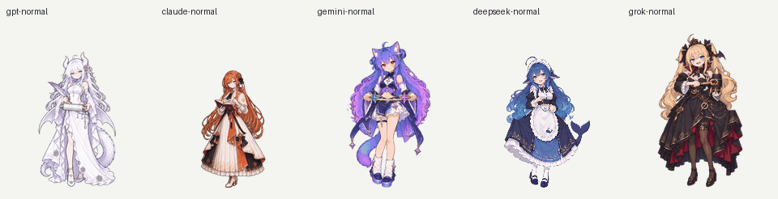
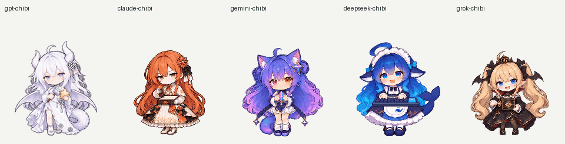

# Codex AI Companions

把 AI 娘带进自己的 Codex。DeepSeek 鲸鱼娘、GPT 龙娘、Claude 娘、Grok 娘、Gemini 双子猫娘，各有正常版与 Q 版，共十只原生 Pet。

本仓库提供 **十只 v5 原生 Pet、一条命令导入和动作预览**。


## 导入自己的 Codex

需要支持自定义 Pet 的 Codex 桌面客户端，以及 [Node.js 20+](https://nodejs.org/)。只导入原生 Pet，无需安装 npm 依赖。

### 1. 下载并导入

macOS 终端或 Windows PowerShell 均可运行：

```sh
git clone --depth 1 https://github.com/chenachen/codex-ai-companions.git
cd codex-ai-companions
node scripts/import-pets.cjs
```

也可以在 GitHub 点击 **Code → Download ZIP**，解压后在项目目录运行最后一条命令。

默认导入全部十只。只想要一只，或先看看名字：

```sh
node scripts/import-pets.cjs --list
node scripts/import-pets.cjs deepseek-chibi
node scripts/import-pets.cjs gpt-normal gemini-chibi
```

| 角色 | 正常版目录名 | Q 版目录名 |
| --- | --- | --- |
| DeepSeek 鲸鱼娘 | `deepseek-normal` | `deepseek-chibi` |
| GPT 龙娘 | `gpt-normal` | `gpt-chibi` |
| Claude 娘 | `claude-normal` | `claude-chibi` |
| Grok 娘 | `grok-normal` | `grok-chibi` |
| Gemini 双子猫娘 | `gemini-normal` | `gemini-chibi` |

### 2. 在客户端选中

打开 **Settings → Pets → Refresh**，选择刚导入的角色。在聊天输入 `/pet` 显示宠物。该入口以 [OpenAI 官方 Pets 文档](https://learn.chatgpt.com/docs/pets)为准。

安装器将 `pet.json` 和 `spritesheet.png` 复制到本机 Pet 目录。默认位置：

- macOS：`~/.codex/pets/codex-ai-companions-<角色目录名>/`
- Windows：`%USERPROFILE%\.codex\pets\codex-ai-companions-<角色目录名>\`

设置过 `CODEX_HOME` 时，使用该目录下的 `pets/`。终端和桌面客户端需使用相同的 Codex 配置目录。

### 更新、手动导入与移除

重复导入相同素材会跳过。已有同名素材且内容不同时，安装器会停止；确认替换后运行：

```sh
node scripts/import-pets.cjs --force deepseek-chibi
```

不安装 Node.js 也能手动导入：从 `pets/` 选择角色，将其中两个文件复制到上述对应目录。以 DeepSeek Q 版为例：

```text
~/.codex/pets/codex-ai-companions-deepseek-chibi/
├── pet.json
└── spritesheet.png
```

随后在客户端刷新。移除时删除这一个角色目录，再刷新即可。

若角色没有出现，先检查 `pet.json` 是否直接位于角色目录中，避免多套一层文件夹；再检查 `CODEX_HOME` 是否一致。看不到 Pets 设置时，检查桌面客户端是否支持该功能。

## 动作预览

正常版：



Q 版：



每只包含九种动作和 16 个注视方向。PNG 图集为 1536×2288，使用 `spriteVersionNumber: 2`；v5 指本项目素材修订号。动画播放速度由客户端控制，GIF 用于预览，原始 PNG 用于导入。

想查看所有状态和深浅背景：

```sh
npm run preview:native
```

用浏览器打开生成的 `outputs/preview/native-pets.html`，保留它与仓库其他目录的相对位置。[终稿校验清单](docs/native-pets-manifest.json)记录十张 PNG 的 SHA-256。

## 项目结构与验证

| 目录 | 内容 |
| --- | --- |
| `pets/` | 十只 Pet，每只包含 `pet.json` 和 `spritesheet.png` |
| `scripts/` | 导入器、导入测试和原生动作预览构建器 |
| `docs/` | 预览图片、素材来源和 PNG 校验清单 |

```sh
npm test
```

测试在临时目录验证导入、重复运行、冲突保护和更新，结束后自动清理，不改动实际安装。预览生成到 `outputs/preview/`，不提交到 Git。修改素材前可查看 [项目约定](AGENTS.md)。

## 许可证与署名

代码采用 [MIT](LICENSE)。**角色图片、动画和模型标志不在 MIT 授权范围内**；DeepSeek 相关改编沿用 CC BY-NC-SA 4.0，其他素材按各自来源处理，见 [素材来源与授权](docs/ASSETS.md)。本项目为社区二次创作，与各模型厂商无官方隶属关系。
